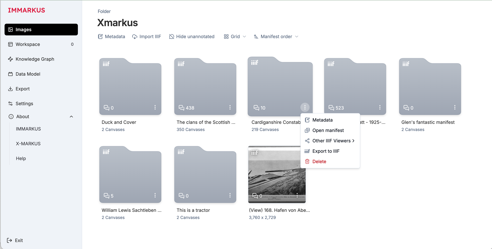
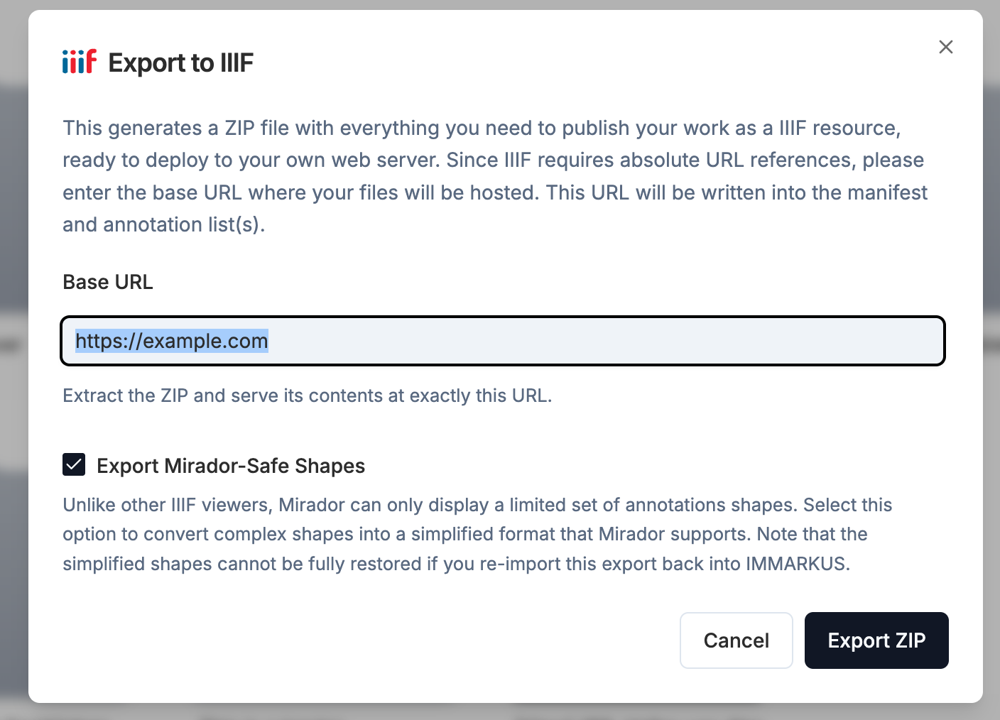
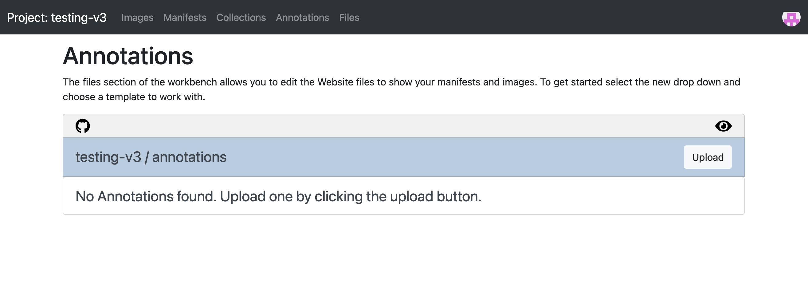
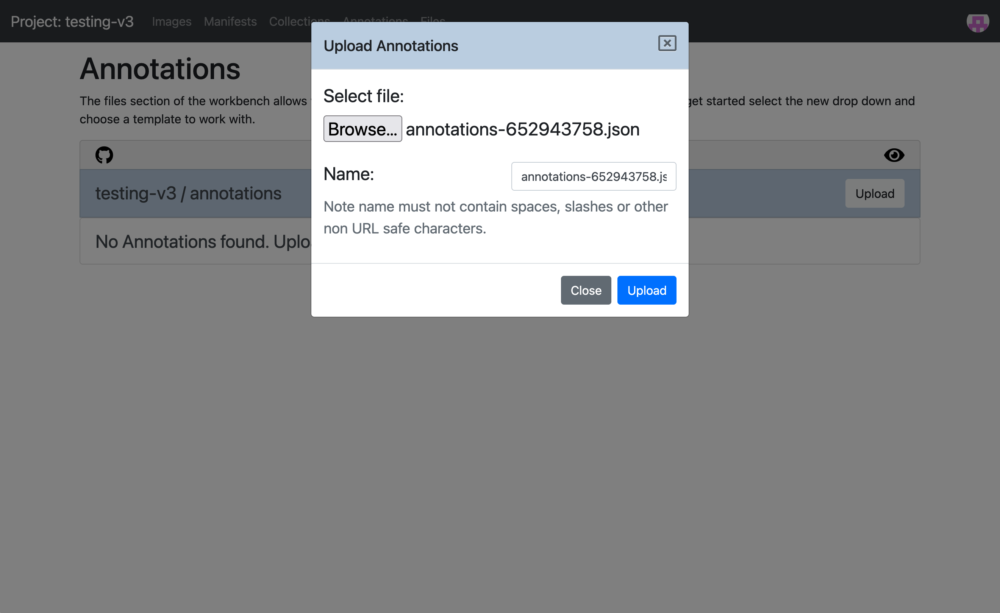
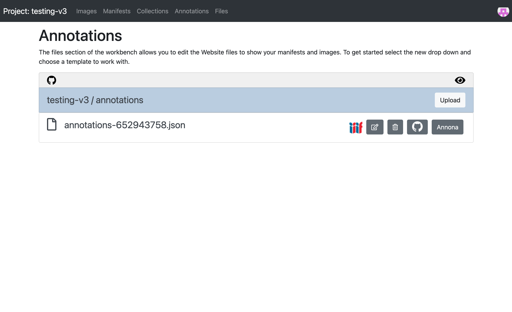
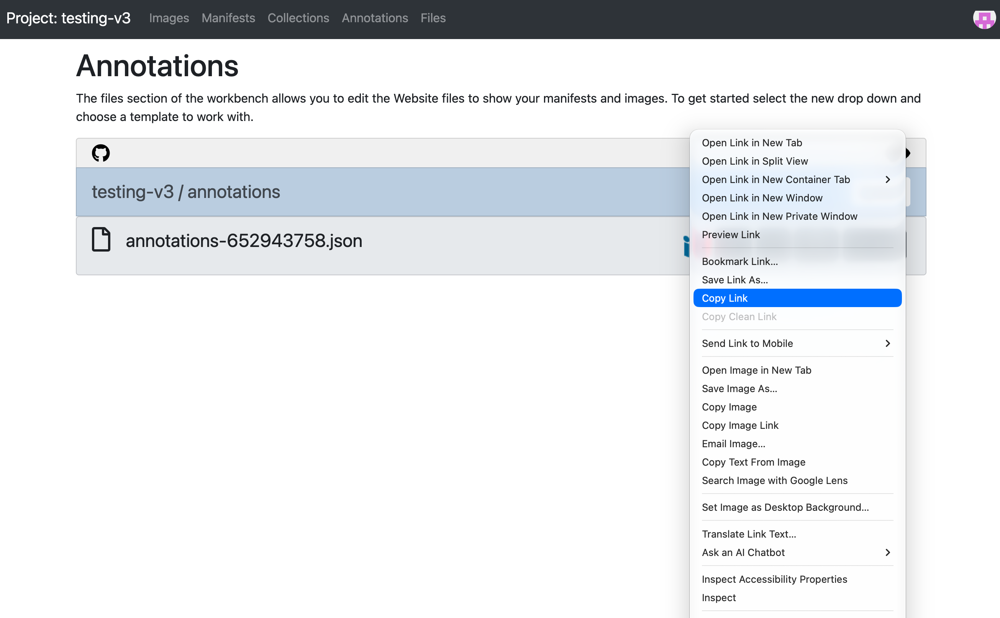
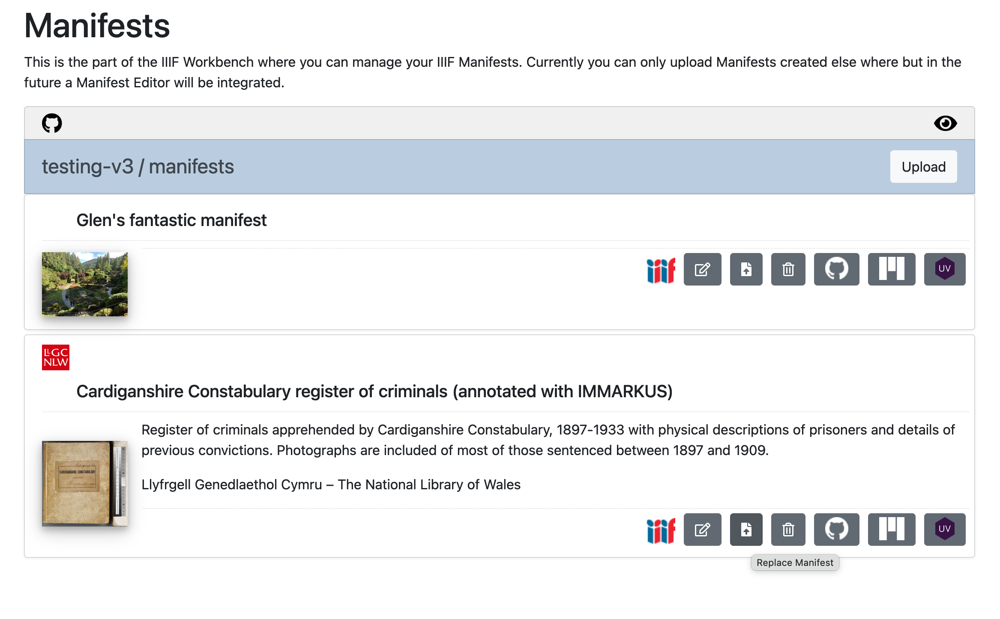

# Downloading and linking your annotations

Once you have annotated your Manifest using IMMARKUS the final step is to link these annotations and publish both the annotations and the Manifest to the Workbench so you can view the results in a viewer like Mirador. 

We have been annotating Canvases in IMMARKUS so the process of linking the annotations is to add a `annotations` field to the IIIF canvas. In IIIF version 3 it is possible to embed the annotations directly into the Manifest. This works OK for a very small number of annotations but if you have many annotations it makes the Manifest a lot larger to process and will be slower to open in a Viewer. A better method is to link to a JSON file called an `AnnotationPage` which contains all of the annotations for that Canvas. For a detailed description of linking to an AnnotationPage you can see this [Embedded or referenced Annotations](https://iiif.io/api/cookbook/recipe/0269-embedded-or-referenced-annotations/) cookbook recipe. 

In the recipe the JSON for the canvas looks as follows:

```
{
    "id": "https://iiif.io/api/cookbook/recipe/0269-embedded-or-referenced-annotations/canvas-1",
    "type": "Canvas",
    "height": 3024,
    "width": 4032,
    "items": [{
        "id": "https://iiif.io/api/cookbook/recipe/0269-embedded-or-referenced-annotations/canvas-1/annopage-1",
        "type": "AnnotationPage",
        "items": [{
            "id": "https://iiif.io/api/cookbook/recipe/0269-embedded-or-referenced-annotations/canvas-1/annopage-1/anno-1",
            "type": "Annotation",
            "motivation": "painting",
            "body": { ...image information ...},
            "target": "https://iiif.io/api/cookbook/recipe/0269-embedded-or-referenced-annotations/canvas-1"
        }]
    }],
    "annotations": [{
        "id": "https://iiif.io/api/cookbook/recipe/0269-embedded-or-referenced-annotations/annotationpage.json",
        "type": "AnnotationPage"
    }]
}
```

Note the `annotations` field at the bottom is pointing to the `AnnotationPage`. This is the JSON file which contains your annotations. Also note in the Canvas `items` there is also an `AnnotationPage` but any annotations which are under `items` must have a `motivation`: `painting`. Any annotations with other motivations like `commenting` or `tagging` must go in the `annotations` field. 

IMMARKUS has two way of exporting annotations. One of the ways is through the Export on the left hand side panel. This will export all of the annotations for everything you have annotated in IMMARKUS. To link these annotations to a canvas you would have to create an AnnotationPage per canvas and manually move the annotations from the big export into the corresponding AnnotationPage. This export all functionality is useful if you want to further process the annotations or load them into a Linked Data store like in the Book of Remembrance project mentioned earlier. For linking Annotations to the Canvas we have to use a different export. 

### Step 1: Export annotations from IMMARKUS
To export page level or Canvas level annotations navigate to the Images menu item at the top left of the screen. Then press the three vertical dots next to the image of your Manifest. One of the options should be "Export to IIIF". If you select that one it should take you to the export screen.



The export will produce a Zip file containing the AnnotationPages and a copy of the Manifest which contains links to the AnnotationPages for each canvas. This export is built for the use case where you could extract the zip file and publish using a Web server. This is why the export asks for a Base URL. If we were to set the base url to `https://example.com` then the exported Manifest would contain links to the AnnotationPages in the form:

```
"annotations": [{
    "id": "https://example.com/5d67df3dbf063944/annotations-1803933263.json",
    "type": "AnnotationPage"
}]
```

Where:
 * `https://example.com` is the base_url
 * `5d67df3dbf063944` is the IMMARKUS identifier for the Manifest and is the directory name in the Zip file.
 *  `annotations-1803933263.json` is the name of the AnnotationPage in the Zip file. 

You will also notice the ID of the manifest is:

```
"id": "https://example.com/5d67df3dbf063944/manifest.json",
```

and the ID of one of the AnnotationPages is:

```
"id": "https://example.com/5d67df3dbf063944/annotations-652943758.json",
```

Which you will note matches the link used in the Canvas `annotations` field. 

To upload these annotations to the IIIF Workbench we will need to update the `annotations` links so that they point to the Workbench locations of the Annotations. The ID fields of both the Manifest and AnnotationPage will get updated automatically by the Workbench so we can leave them as they are.

So back to the export, if you enter https://example.com in the base URL and click Export Zip:



If you expand the Zip file you should find a directory with a manifest.json and a json file per page you annotated: 

```
5d67df3dbf063944/
 manifest.json
 annotations-1312088300.json
 annotations-1448412063.json
 annotations-1684342079.json
 annotations-1803933263.json
 annotations-652943758.json
``` 

Note the numbers in the directory name and in the annotation files will be different for you. 

### Step 2: Upload your annotations to Workbench

For each AnnotationPage we will upload it to the IIIF Workbench then get the final URL and replace the link in the Manifest to point to the AnnotationPage in the IIIF Workbench. 

In a new Browser tab navigate to your Workbench by going to https://workbench.gdmrdigital.com/login.xhtml and logging in. Select the project you are working on and click the Annotations section.



Now upload one of the AnnotationPage files from the Zip file:



Once you have uploaded your annotations you should see the screen below. 



It takes about 10mins for the Workbench to publish the annotation list to your Website but we can still copy the URL to the AnnotationPage to move on to the next stage. To do this right click on the IIIF logo and select "Copy Link" to copy the URL of your annotations. This is what we will add to your manifest.



### Step 3: Updating the Manifest to point to the Workbench

Now we have uploaded the AnnotationPage we need to update the Manifest to point to the Workbench version of the annotations. Open up the Manifest from IMMARKUS in VS Code and search for the annotations file name. In my example I would be searching the Manifest for `annotations-652943758.json` and I would find the following:

```
"annotations": [
{
    "id": "https://example.com/5d67df3dbf063944/annotations-652943758.json",
    "type": "AnnotationPage"
}
]
```

using the URL copied from the Workbench IIIF logo I would change the id to be:

```
"annotations": [
    {
        "id": "https://iiif-test.github.io/testing-v3/annotations/annotations-652943758.json",
        "type": "AnnotationPage"
    }
]
```

Now you can upload each AnnotationPage contained in the Zip file and update the Manifest each time with the new location. 

### Step 4: Upload your Manifest and test in Mirador

Once you have uploaded all of the AnnotaitonPages and made all of the edits to the Manifest you can upload the Manifest. If this is a copy of a Manifest already in the Workbench you can click the replace button. Otherwise click the upload to upload a new Manifest.



Once the Github Pages website has finished updating then you should be able to click the Mirador link and view your annotations. Note the Universal Viewer doesn't currently support annotations.