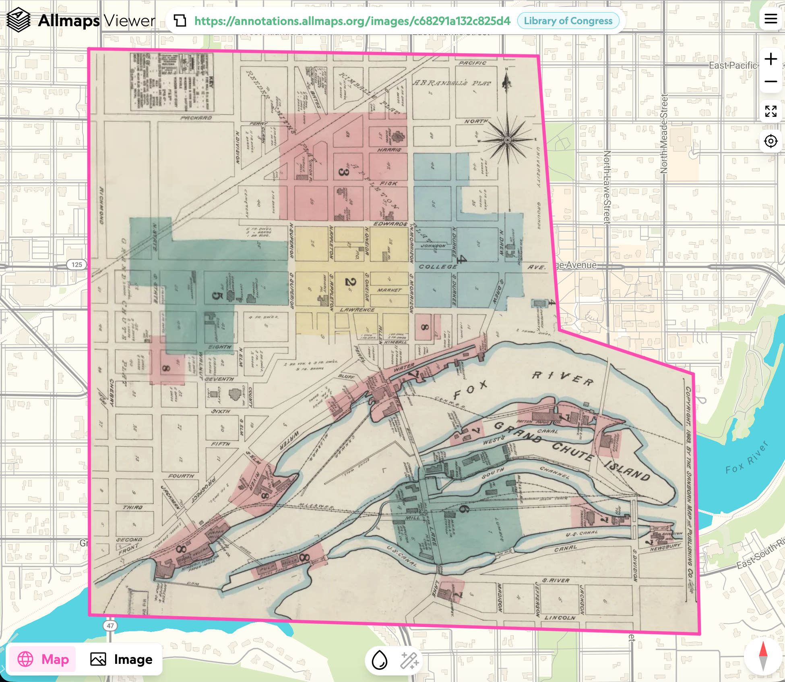
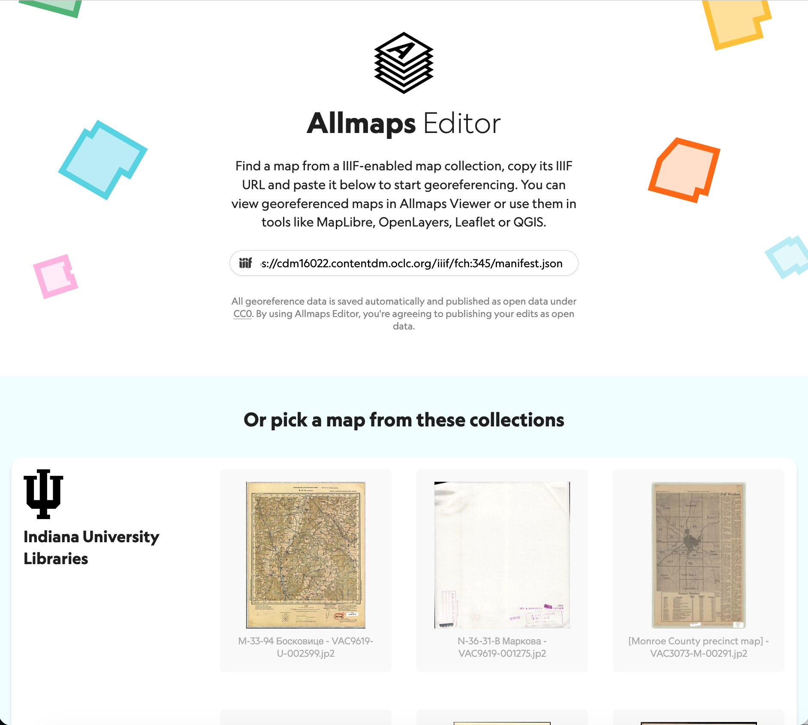
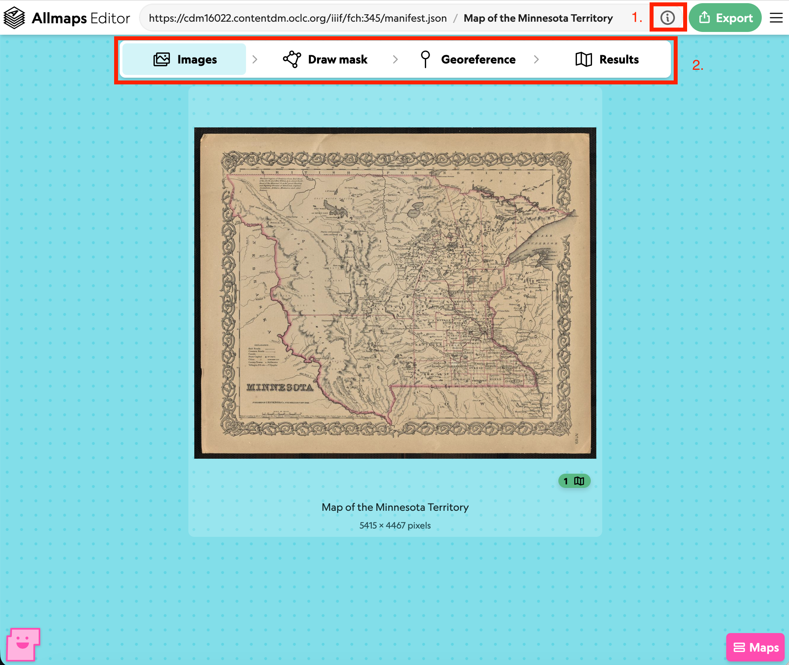
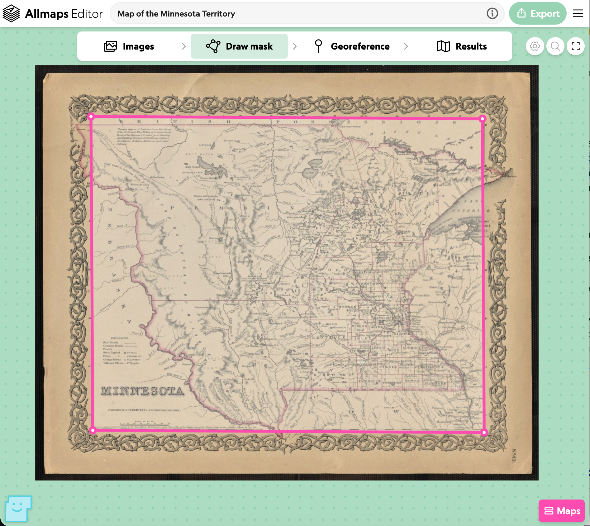
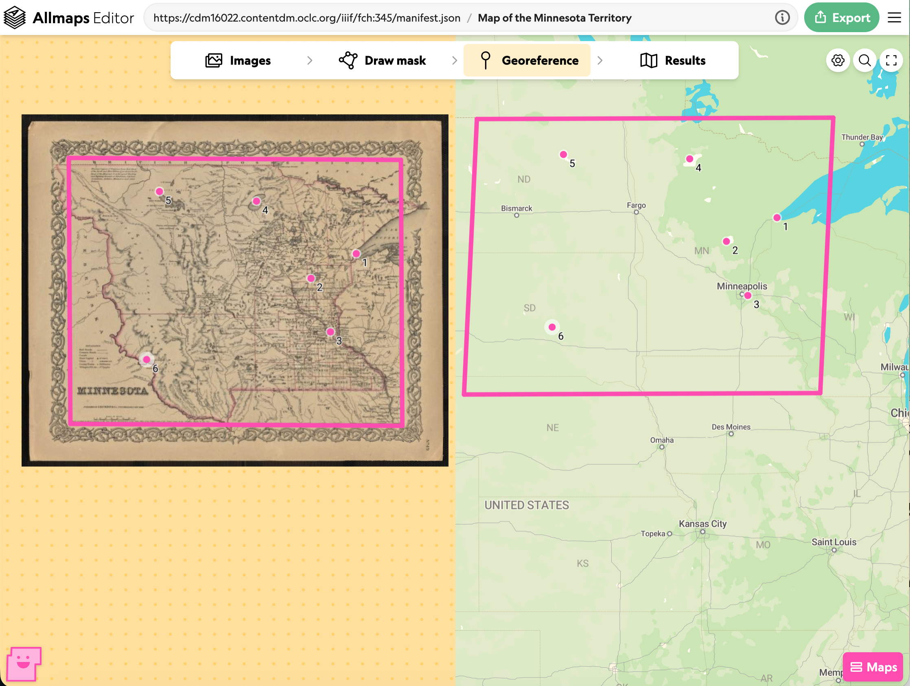
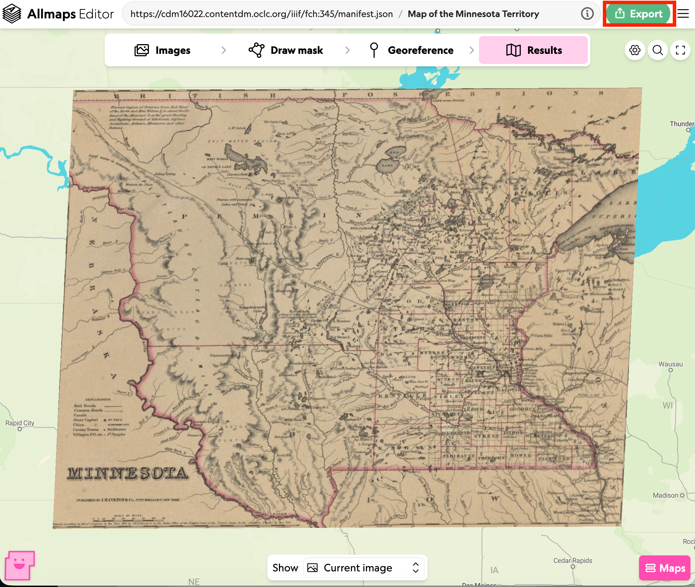
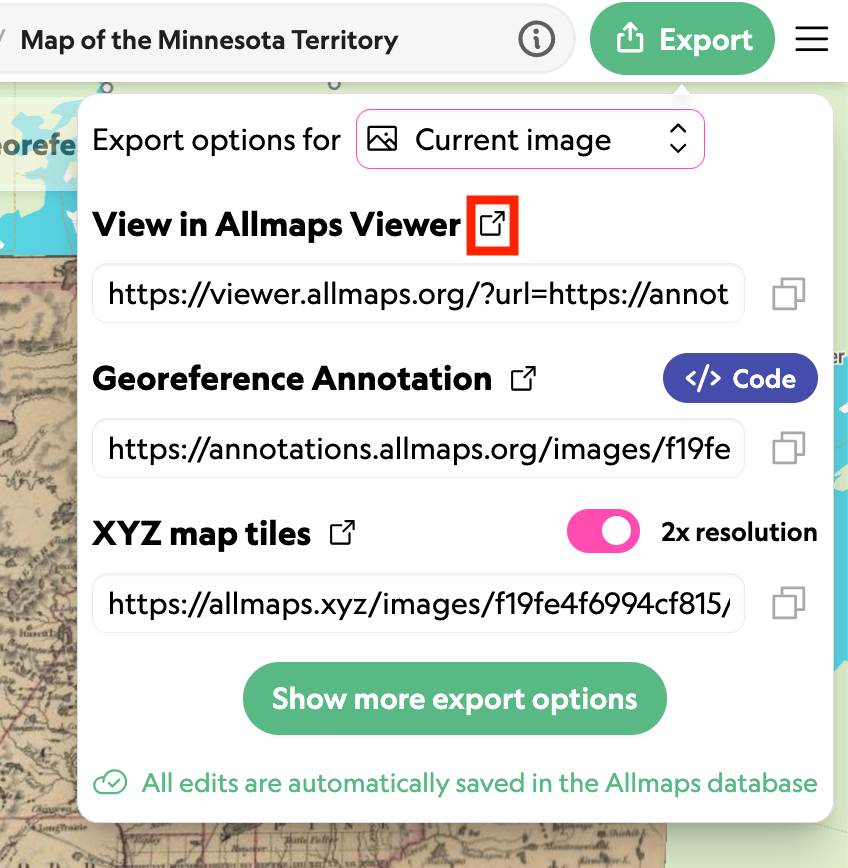
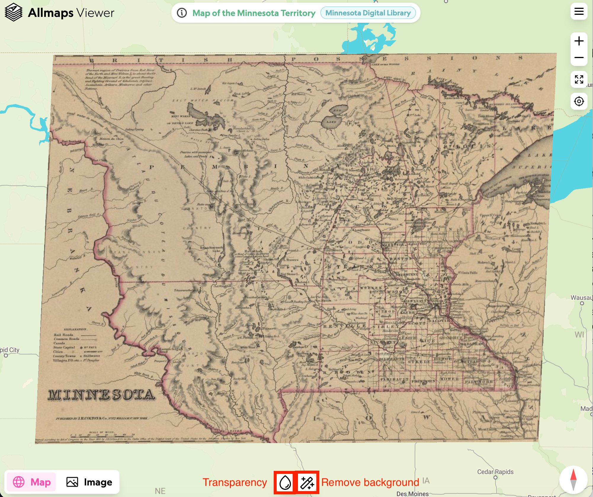

# Georeferencing with Allmaps

Georeferencing is the process of assigning real-world spatial coordinates to a digital image or scanned map. It links pixels or shapes to a specific coordinate system, allowing data to be displayed, queried, and analyzed inside a Geographic Information System (GIS). From [Wikipedia](https://en.wikipedia.org/wiki/Georeferencing)

Or more simply it allows you to overlay a historical map onto a modern map so you can see how places have changed over time. 

## Opening a Manifest in Allmaps 

In the previous step we learned how to copy a Manifest URL and we will use this in Allmaps to open up the image for Georeferencing. As mentioned previously the Manifest has links to the images and this is what Allmaps uses. So Allmaps does not download the images it just uses the Minnesota images live on the website. 

Use the Manifest URL you copied from the previous step but if you had any problems you can use the following Manifest:

https://cdm16022.contentdm.oclc.org/iiif/fch:345/manifest.json

The next step is to navigate to the Allmaps Editor:

https://editor.allmaps.org/

At the top there is a box where you can paste your Manifest URL and press enter to load it.

This will take you to the Editor Images screen which will show you all of the images that are part of this Manifest. This Manifest only has a single image but we will look at a Manifest with multiple images in the next section. 

I've highlighted a few features of the Allmaps editor:

1. Click this i info box to see the Metadata for this Manifest. Note to the left of this box the Editor shows the Manifest Label.
2. This is the stages of Georeferencing that we will go through from left to right. It is possible to go back through the stages so after viewing the results you can go back and improve the Georeferencing or Masking. 

The next stage is to create a mask so click the Draw Mask button at the top.

## Creating a Mask

The first stage of the Georeferencing is to identify the part of the page that is a Map. In this example most of the image is a map but you can imagine in an Atlas it might only be part of a page or in a book it might have a map surrounded by text. It is also possible to add multiple maps if the page contains multiple maps for example some maps have insets for detailed maps of towns. 

For this example we are going to identify the map part of the image and ignore some of the surrounding parts of the page. I am going to do a rectangle but it is possible to add as many points as you want to identify the boundary of the map. 

To start click onto a corner of the map and this will create one point and a line that follows your curser. Next create a second corner and then a third corner. To finish the shape either click on the first point or click the finish button at the top. 

Once you've done this it should look something like:

Don't worry about getting it too precise as you can always come back and work on making the map a better fit. Next click on the Georeference button at the top. 

## Adding Ground Control Points

On the Georeference screen you will see two maps. The one on the left will be your IIIF map you've imported. The one on the right will be a modern map. The process of Georeferencing requires points to be put on the IIIF map and corresponding points to be put on the modern map. Once there are enough linked points on both maps it will be possible to overlay the historical map onto the modern map. 

Using the modern map zoom into the location where the IIIF map depicts. Then click on a point on the IIIF map and you will see a dot with a 1 next to it. Find the corresponding point on the modern map and click and you should see another point with a 1 on it. If you need to delete a point right click on it. 

Add points to both the historical and modern maps. Try and do the four corners and unless you are going for high accuracy you should be OK with 4-5 points to get result in the viewer. 

Once you have got enough, there should be an outline of the historical map on the Modern map. If the shape looks right you can click on Results. If it doesn't look right add more control points to the two maps. 

## Viewing the results

You should see the IIIF map overlaid on to the modern map. This is a very basic viewer just allowing you to see the georeferencing you've done. If you want to adjust the Mask or control points you can go back by clicking the links at the top. 

To access the fully featured Allmaps Viewer click the export button at the top of the results screen. 

This dialog will allow you to export the Georeferencing control points as a IIIF Annotation. This Annotation uses an extension to the IIIF specifications called the [Georeference Extension](https://iiif.io/api/extension/georef/). This screen also shows a XYZ map tile link which is another standard way of accessing maps and this can be used to import into a Georeferencing tool like ArcGIS or QGIS.

For this workshop click on the highlighted link to the Allmaps Viewer:

This will open the Allmaps viewer which allows you to zoom into the map. It also has two tools at the bottom. The left hand side gives you a slider to adjust the transparency of the IIIF map so you can see the modern map underneath. The tool on the right removes the background colour of the map so you can see both the map and the modern map. 

