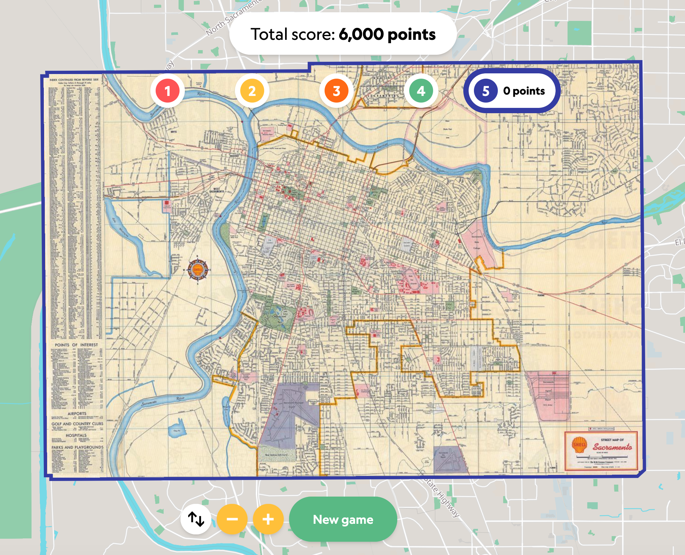

# Arcade

I left this till last as I suspect I will lose you all in this game. This is a game developed by the Allmaps team and the idea is to match the IIIF map with the location on a modern map. You get points the quicker you are able to match the locations. It can be accessed at the following URL but the Allmaps team have also got a [reconditioned arcade](https://www.instagram.com/reel/C48Ja1JNC3j/) which they brought to the last conference. 

https://arcade.allmaps.org/

