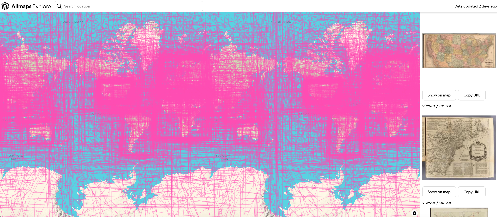

# Explore

The explore interface is currently a prototype and works is planned to improve this through funding from the IIIF Allmaps partnership which I will talk about later. 

It is useable and shows how many maps are available but the Allmaps team are looking at making it more user friendly and for IIIF and Allmaps partners you will be able to facet by an institution. 

https://dev.explore.allmaps.org

