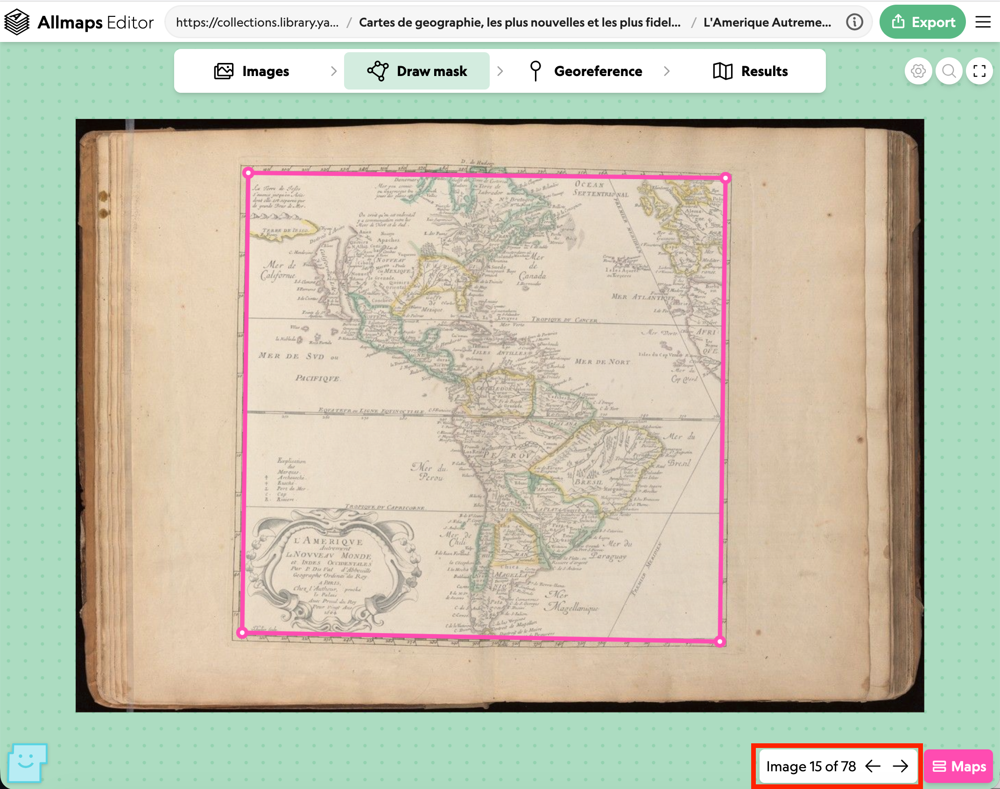
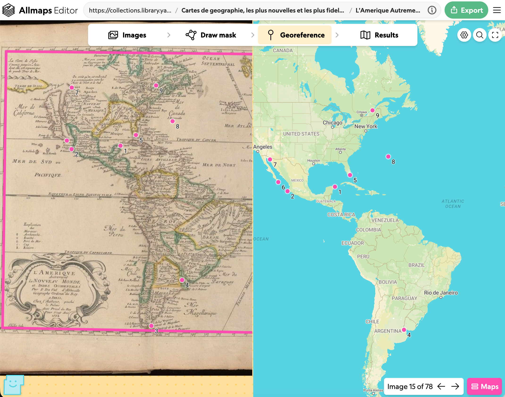
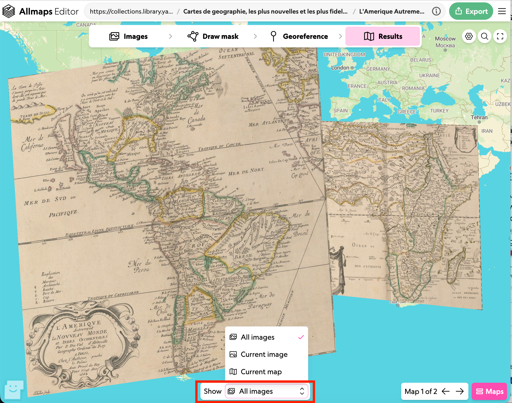

# Atlases and multi page manifests

So far we have looked at single page items but Allmaps also works with multi page items. Below is an example of an Atlas created by Pierre Du Val (1619–1683) called "Cartes de geographie, les plus nouvelles et les plus fideles, auecque leurs diuisions régulieres, par P. du Val ..." from Yale University Collections.

https://editor.allmaps.org/images?url=https%3A%2F%2Fcollections.library.yale.edu%2Fmanifests%2F16580278&image=https%3A%2F%2Fcollections.library.yale.edu%2Fiiif%2F2%2F16585646

As you can see from the images tab some of the images are maps and some of the images are text. If you go to the Draw Mask tab you can navigate through the images and add Masks to the maps that are in the atlas. In the image below I've highlighted the image navigation which is at the bottom right of the screen.

This image navigation is present on the Georeference screen too and allows you to georeference each image which has a mask applied.

On the results screen you can either view the individual images by changing the show menu at the bottom or show all of the images from the Manifests which have been georeferenced overlaid on the modern map. 

