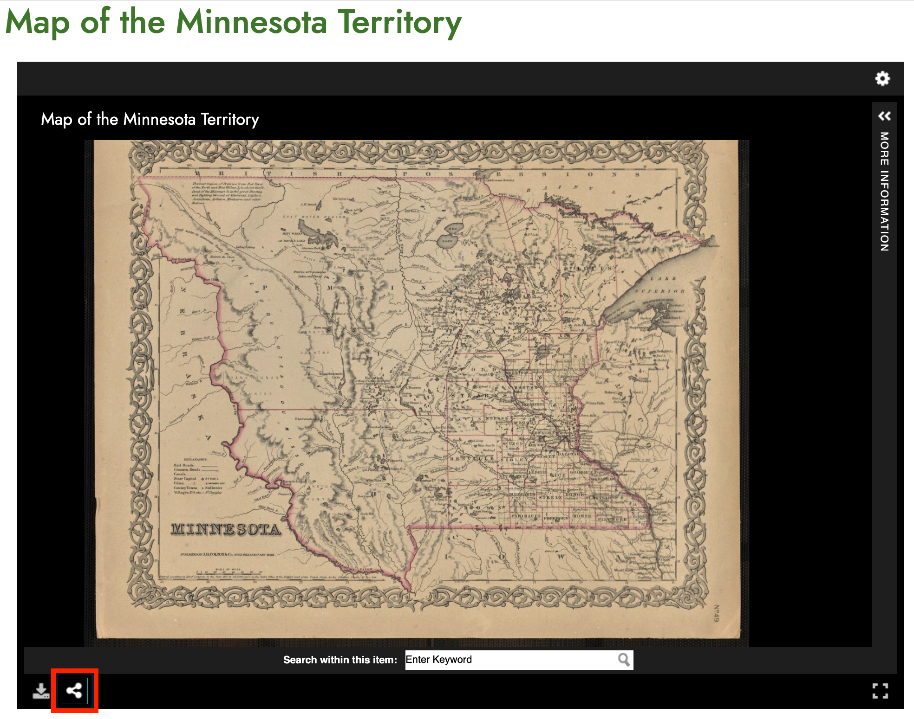
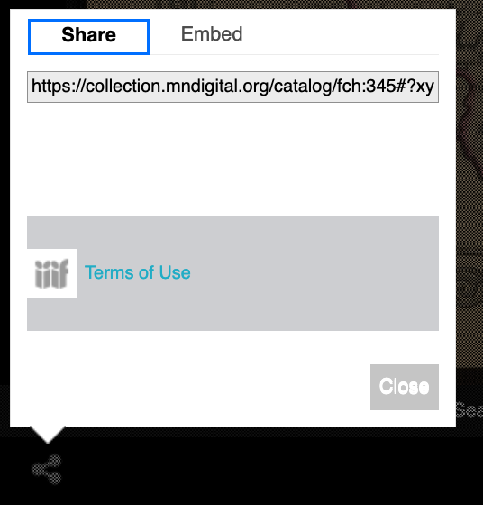
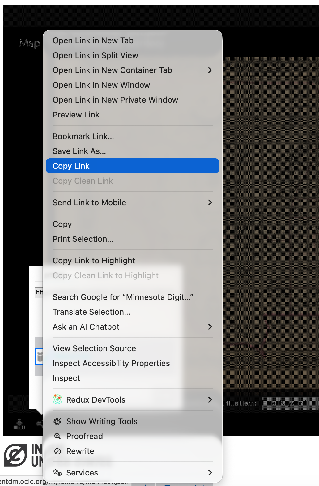
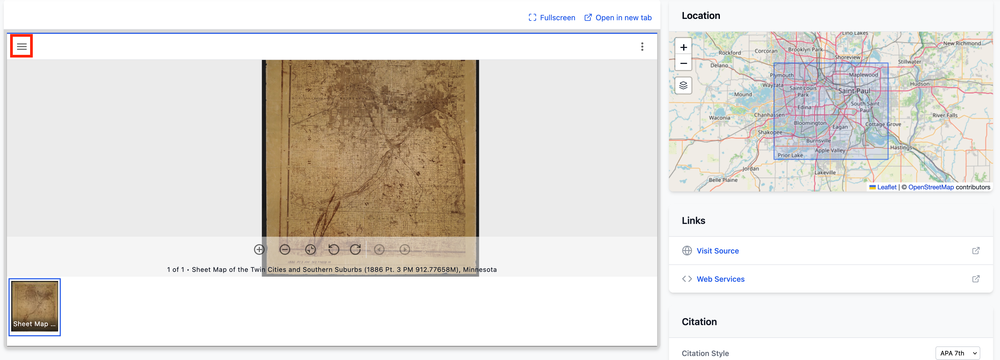
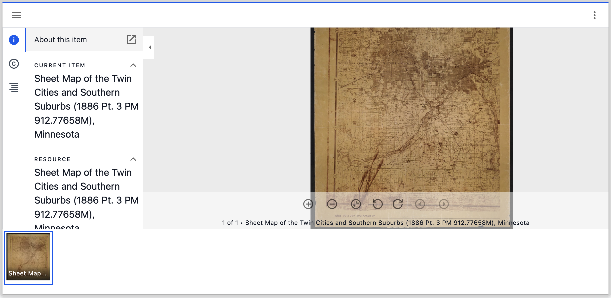
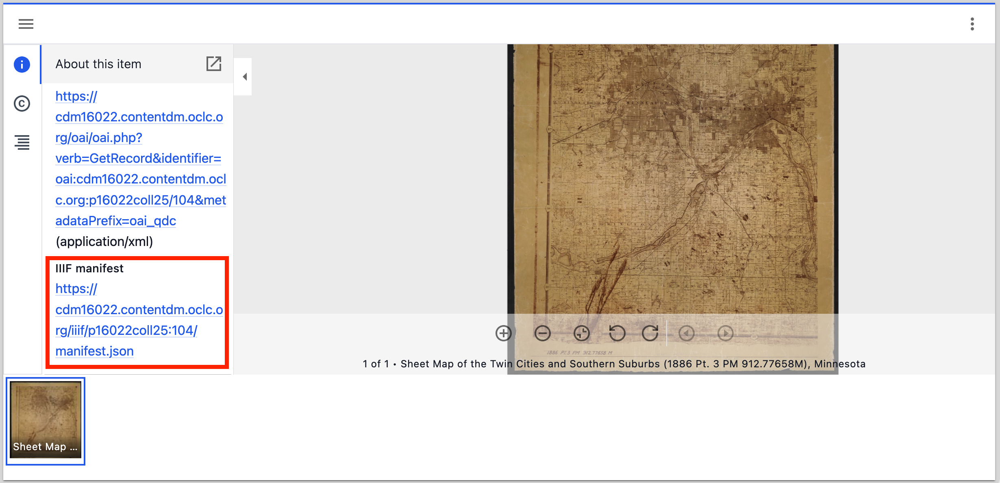
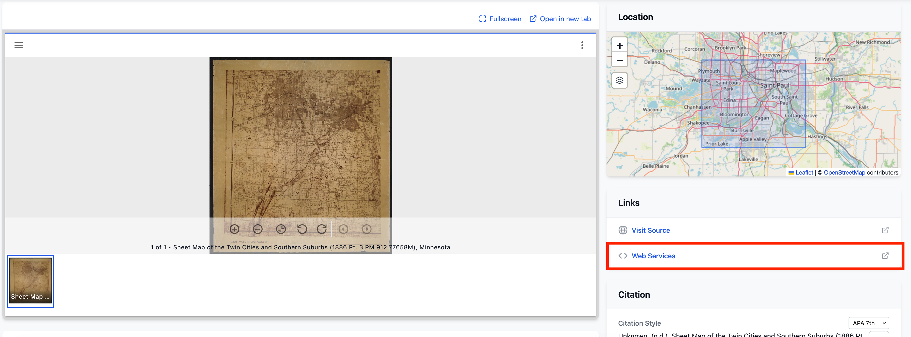
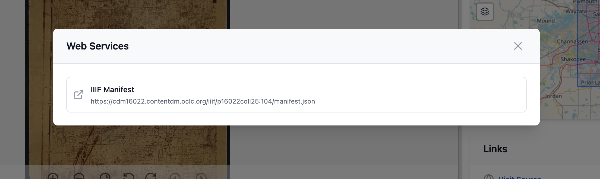
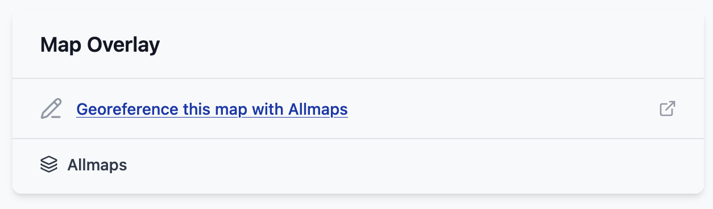

# Finding IIIF resources

## What is a IIIF Manifest?

When a library or museum puts a map online using IIIF, it publishes two things:

* **Images** – the scanned map, which you can zoom into in great detail.
* **A Manifest** – a small JSON file that describes the map and points to the image.

You can think of the Manifest as the **label and packing slip** for a digital object. It says what the item is (its title, date, creator and rights) and where to find its images. If the object has more than one image, such as the pages of an atlas, the Manifest lists them all in order.

The important thing about a Manifest is that it lives at a web address (a URL). Because every IIIF Manifest follows the same standard, any IIIF tool can read it. You don't need to download the map images; you give the tool the Manifest URL and it loads the map straight from the library's website.

Allmaps works this way. To georeference a map you only need to give Allmaps the link to its IIIF Manifest.

## Finding IIIF Manifests

This has been an issue the IIIF community has been struggling with for a while. There is no standard way to access IIIF Manifests but we have some recommendations on using the IIIF logo to indicate there is a Manifest. 

A good example for sharing the IIIF Manifest is this from Biblissima:

The features of this interface are:
 * If you click the IIIF logo it gives information about what the IIIF standard is for
 * You can either click the copy button or right click on the URL and do copy link. 
 * It makes the IIIF manifest link very prominent on the page. 

During COVID St Andrew's University started collecting guides on how to access IIIF resources from different institutions. The IIIF community has now adopted this guide and maintains it. You can access the guide at:

[https://guides.iiif.io](https://guides.iiif.io)

You will see after going through a number of institutions each one does it slightly differently. Most use the IIIF logo in some way but sometimes it takes you to a Viewer and sometimes it takes you to a Manifest. 

## Minnesota Digital Library Manifests

Looking at this [Map of the Minnesota Territory](https://collection.mndigital.org/catalog/fch:345#?xywh=-433%2C335%2C6799%2C4136) from the Minnesota Digital Library it doesn't look like there is a IIIF logo. Luckily it uses one of the popular IIIF Viewers called the [Universal Viewer](https://universalviewer.io/). This has a way of getting to the Manifest and works with all instances of the Universal Viewer. 

To find the IIIF Manifest click the share button highlighted below:

If you click this button it will then popup a share dialog with a IIIF logo:

Now right click on the image and select "Copy Link" in Firefox or "Copy Link Address" in Chrome:

If you paste this URL into a text file you should see something like:

https://cdm16022.contentdm.oclc.org/iiif/fch:345/manifest.json?manifest=https://cdm16022.contentdm.oclc.org/iiif/fch:345/manifest.json

Due to a bug with the Universal Viewer it actually puts the Manifest URL twice so you can delete everything after the `?` but don't worry the full URL still works in Allmaps. The resulting Manifest URL will look like:

https://cdm16022.contentdm.oclc.org/iiif/fch:345/manifest.json

## BTAA Geoportal Manifests

Looking at the BTAA Geoportal there are a three ways to get access to the IIIF Manifest. Unfortunately there isn't a IIIF logo but this again uses a different popular IIIF Viewer called [Mirador](https://projectmirador.org/). The three options for getting a Manifest are listed below. Note they are ordered in the most complicated to the easiest at the end.

### Option 1: Using Mirador to get the IIIF Manifest

This method works in most versions of Mirador and requires you to find the Metadata section of the Mirador viewer. The first step is to click on the Hamburger symbol highlighted below:

If you click this button you will open the Mirador Metadata panel which will show the Metadata, rights and any table of contents for this Manifest if it were present. 

If you scroll down to the bottom of this panel you will see the link to the Manifest. This can be copied as above by right clicking and selecting "Copy Link" in Firefox or "Copy Link Address" in Chrome. 

Note Mirador does not have the same issue as the Universal Viewer and if you paste the URL in a text file you will see the link looks like:

https://cdm16022.contentdm.oclc.org/iiif/p16022coll25:104/manifest.json

### Option 2: Use the Web Services link

An easier option is to click the Web Service link highlighted in the image below:

This will popup a dialog where the Manifest URL can be copied:

### Option 3: Click the Allmaps link

The final option is the easiest option as it compbines finding the Manifest URL with the next step which is opening the Manifest URL in Allmaps. 

If you scroll down the page on the right hand side you should see a "Georeference this map with Allmaps". 

This will take you straight to Allmaps with the current map loaded. 